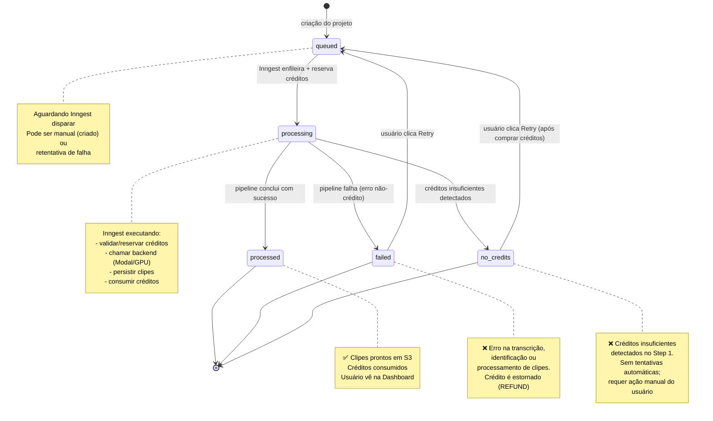
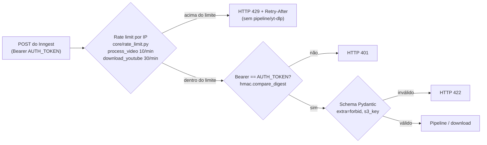
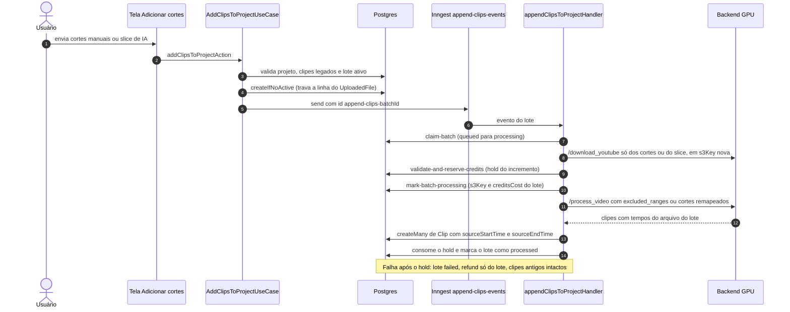

# Arquitetura do Fluxo de Processamento de Vídeo

Este documento descreve o fluxo completo de processamento de podcasts em clipes verticais, desde a importação do vídeo até a entrega dos clipes finais no S3. Ele reflete a **consolidação do pipeline** realizada para eliminar drift entre ambientes (Modal/produção e GPU local/dev).

## Visão Geral: Fluxo Ponta a Ponta

```mermaid
flowchart TD
    A["👤 Usuário importa vídeo do YouTube"] -->|Frontend| B["CreateProjectClient: gera S3 key + cria UploadedFile"]
    B -->|status: queued| C["Inngest recebe ProcessVideoEvent"]
    
    C -->|Step 1: validate-and-reserve-credits| D{["Baixar do YouTube (se aplicável)<br/>Validar duração do plano (manual: soma dos cortes)<br/>mode=manual sem cortes ou corte além do vídeo: erro, sem hold<br/>Reservar créditos (HOLD)<br/>manual: preço por cortes / auto: preço por duração"]}
    D -->|Hold bem-sucedido| E["Step 2: mark-processing"]
    D -->|Insuficiente de créditos| F["❌ Status: no credits"]
    
    E -->|Status: processing| G["Step 3: call-modal-gpu"]
    G -->|HTTP POST ao PROCESS_VIDEO_ENDPOINT| H["Modal (Produção) OU GPU Local (Dev)"]
    
    H --> I["core/video_pipeline.run_video_processing_pipeline(request, storage, moments_provider)"]
    I -->|"download_file(s3_key)<br/>(cópia direta se s3_key existe no disco)"| PORT
    I --> I1{"request.mode"}
    I1 -->|"auto"| A1["1. Transcrição (WhisperX)"]
    A1 --> A2["2. moments_provider.identify_moments<br/>(porta MomentsProvider)<br/>clips[:5] (clips_limit)"]
    I1 -->|"manual"| M1["1. ffprobe: duração real do vídeo"]
    M1 -->|"algum corte end > duração"| MX["HTTP 422: requisição inteira rejeitada<br/>sem transcrição e sem clipes"]
    M1 -->|"todos os cortes dentro da duração"| M2["2. Transcrição (WhisperX) só dos cortes<br/>(margem 0,5s, intervalos sobrepostos mesclados)<br/>serve às legendas"]
    M2 --> M3["Gemini PULADO<br/>clipes = manual_cuts (todos, sem limite de 5)"]
    A2 --> K["Para cada clipe"]
    M3 --> K
    K --> L["core/clip_pipeline.process_clip"]
    
    L --> M["3. Corte + Detecção de Fala Ativa"]
    M -->|FFMPEG: corta segmento| N["4. LR-ASD: detecta falante ativo"]
    N -->|OpenCV/FFMPEGCV: reframe vertical| O["5. Vertical Reframe 9:16"]
    O --> D{"preset == NONE?<br/>(Sem Legenda)"}
    D -->|"não: pysubs2 + FFMPEG queima legendas"| P["6. Legendas Stylizadas"]
    D -->|"sim: desvio, pula a etapa 6"| Q
    P -->|"upload_file(clip, clips/...)"| Q["7. Upload do clipe final (clips/)"]
    Q --> PORT
    
    subgraph STORAGE["Porta ObjectStorage (core/storage/ports.py)"]
        PORT["ObjectStorage<br/>download_file / upload_file<br/>bucket fixo na config"]
    end
    
    PORT -->|"STORAGE_PROVIDER=s3 (sem S3_ENDPOINT_URL)"| AWS[("AWS S3 real")]
    PORT -->|"STORAGE_PROVIDER=s3 + S3_ENDPOINT_URL<br/>(MinIO local: inalcançável pelo Modal)"| MINIO[("MinIO localhost:9000")]
    PORT -->|"STORAGE_PROVIDER=local"| FS[("Sistema de arquivos local")]
    
    Q --> R["✅ Modal retorna ModalProcessVideoResponse"]
    R -->|clips[] metadata| S["Step 4: persist-clips-and-consume"]
    S -->|INSERT INTO Clip| T["Persiste cada clipe no banco"]
    T -->|CONSUME transaction| U["Consome créditos reservados"]
    U -->|Status: processed| V["✅ Projeto concluído com sucesso"]
    
    A2 -->|"porta MomentsProvider"| MP

    subgraph MOMENTS["Porta MomentsProvider (core/moments_port.py)"]
        MP["MomentsProvider<br/>identify_moments(transcript)"]
    end

    MP -->|"MOMENTS_PROVIDER=gemini (default)"| GEM["GeminiMomentsProvider<br/>(core/moments.py)"]
    MP -->|"MOMENTS_PROVIDER=claude"| CLA["ClaudeMomentsProvider<br/>(core/claude_moments.py)"]

    style A fill:#e1f5ff
    style V fill:#c8e6c9
    style F fill:#ffcdd2
    style H fill:#fff9c4
    style I fill:#f3e5f5
    style L fill:#f3e5f5
    style MX fill:#ffcdd2
```

## Estados do Projeto (UploadedFile)

O processamento de um vídeo passa por uma série de estados bem definidos, com suporte a retry em caso de falha:



## Consolidação do Pipeline: Por Que Compartilhamos `core/`?

**Antes da consolidação**, existiam duas implementações distintas:
- `main.py` (Modal/produção): tinha sua própria lógica de pipeline, patches de compatibilidade com PyTorch/torchaudio
- `local_server.py` (GPU local/dev): tinha sua própria versão da mesma lógica, com patches diferentes

Isso causava **drift**: uma mudança em um ambiente poderia não ser refletida no outro, levando a comportamentos diferentes e bugs em produção que nunca apareciam em dev.

**Depois da consolidação**, a lógica real vive em módulos compartilhados dentro de `core/`:
- `core/video_pipeline.py` — orquestração: transcrição → identificação de momentos → processamento de clipes
- `core/clip_pipeline.py` — orquestra por-clip: corte → LR-ASD → reframe vertical → legendas → S3
- `core/transcription.py`, `core/moments.py` (adapter Gemini), `core/claude_moments.py` (adapter Claude), `core/moments_port.py` e `core/moments_factory.py` (porta e seleção de provedor de momentos), `core/active_speaker_detection.py`, `core/vertical_video.py`, `core/subtitles.py` — módulos especializados

Os dois deploy wrappers são **finos**:
- `main.py` — apenas decorators Modal (`@app.function`), gerenciamento de secrets do Modal, nada de lógica
- `local_server.py` — apenas FastAPI routes + env vars locais, nada de lógica

A **única diferença** entre produção e dev agora é a camada de infra/deploy, não a lógica. Isso garante que ambos processem exatamente da mesma forma.

### Upload Direto (Status Atual)

A funcionalidade de upload direto de arquivo de vídeo (`generateUploadUrl`) **existe no backend**, mas está **escondida na UI** por decisão de produto. Atualmente, o único fluxo ativo é a importação via YouTube. Se a feature for reativada, a infra já suporta ambos os fluxos (`sourceType: UPLOAD | YOUTUBE`).

## Armazenamento: porta `ObjectStorage`

O pipeline não usa `boto3` diretamente: recebe um `storage: ObjectStorage` injetado (`core/storage/ports.py`, protocolo com `download_file(key, dest_path)` e `upload_file(src_path, key)`). Quem escolhe o adapter é `core/storage/factory.py::create_object_storage`, chamado por `main.py` (Modal) e `local_server.py` (GPU local).

| Variável | Default | Efeito (verificado em `core/storage/factory.py`) |
|----------|---------|-----------------------------------------------|
| `STORAGE_PROVIDER` | `s3` | `s3` → `S3ObjectStorage`; `local` → `LocalObjectStorage` (cópia de arquivo); qualquer outro valor levanta `ValueError` |
| `S3_ENDPOINT_URL` | vazio | vazio → `boto3.client("s3")` (AWS real); preenchido (ex.: MinIO) → `endpoint_url` + path-style |
| `S3_BUCKET_NAME` | `ai-podcast-clipper` | bucket único do adapter, vindo da config central (nunca do request) |

- No frontend, a mesma seleção fica em `src/infrastructure/factories/storage-gateway.factory.ts`, e com `NODE_ENV=production` um `S3_ENDPOINT_URL` de dev é recusado pelo guard `storage-endpoint-guard.ts`.
- **MinIO não é um provider separado:** é `STORAGE_PROVIDER=s3` + `S3_ENDPOINT_URL`. Ver `../operacao/minio-dev-local.md`.
- **Limitação:** o Modal roda na nuvem e não alcança `localhost:9000`. MinIO só serve ao `local_server.py` (GPU local) e ao frontend em dev.
- **Sem atalho de arquivo local (RNF-SEC-19, 2026-10-11):** `resolve_input_video_path` sempre baixa o vídeo de entrada pela porta `ObjectStorage`, em qualquer `STORAGE_PROVIDER`. O antigo ramo `os.path.exists(s3_key)` → `shutil.copy` foi removido; ele permitia ler qualquer arquivo do container (ex.: `s3_key="/etc/passwd"`).

## Identificação de Momentos: porta `MomentsProvider`

A etapa que lê a transcrição e devolve os clipes candidatos (modo `auto`) não chama um LLM diretamente. O pipeline recebe um `moments_provider: MomentsProvider` injetado. A porta é um `typing.Protocol` (`core/moments_port.py`) com `identify_moments(transcript) -> MomentsExtraction`, no mesmo padrão de `ObjectStorage`, descrito na seção anterior. Quem escolhe o adapter é `core/moments_factory.py::create_moments_provider`, chamado dentro de `load_model()` por `main.py` (Modal) e `local_server.py` (GPU local), ao lado de `self.storage = create_object_storage()`.

| Adapter | Arquivo | Como obtém os momentos |
|---------|---------|------------------------|
| `GeminiMomentsProvider` | `core/moments.py` | Gemini com Structured Outputs (`response_schema=MomentsExtraction`), delegando à função livre `identify_moments` |
| `ClaudeMomentsProvider` | `core/claude_moments.py` | Claude (Anthropic) com tool-use forçado: `tool_choice` aponta para a ferramenta `extract_viral_moments`, com `input_schema=MomentsExtraction.model_json_schema()` |

Os dois adapters usam o mesmo texto de regras (`_IDENTIFY_MOMENTS_PROMPT_TEMPLATE`, de `core/moments.py`), então as regras de duração (30-60s), não sobreposição e timestamps vindos da transcrição são as mesmas nos dois provedores.

| Variável | Default | Efeito (verificado em `core/moments_factory.py`, `core/moments.py`, `core/claude_moments.py`) |
|----------|---------|-----------------------------------------------|
| `MOMENTS_PROVIDER` | `gemini` | `gemini` → `GeminiMomentsProvider`; `claude` → `ClaudeMomentsProvider`; qualquer outro valor levanta `ValueError` (sem fallback silencioso) |
| `GEMINI_API_KEY` | — | Exigida pela factory quando `MOMENTS_PROVIDER=gemini` e nenhum `gemini_client` foi injetado |
| `GEMINI_MODEL` | `gemini-2.5-flash` | Modelo usado pelo adapter Gemini |
| `ANTHROPIC_API_KEY` | — | Exigida pela factory quando `MOMENTS_PROVIDER=claude` e nenhum `claude_client` foi injetado |
| `CLAUDE_MODEL` | `claude-sonnet-5-5` | Modelo usado pelo adapter Claude |

**Regras de comportamento:**

- **Motivo:** o Gemini ocasionalmente devolve `503 UNAVAILABLE` (sobrecarga do lado do Google) nessa etapa. O toggle existe para trocar de provedor sem reverter código.
- **Troca manual, sem failover automático:** a seleção é feita por configuração, no startup. Se o Gemini devolver 503, o pipeline não troca sozinho para o Claude; o operador altera `MOMENTS_PROVIDER` e redeploya/reinicia.
- **Chave Gemini ausente não falha no startup (no wiring atual):** `main.py` e `local_server.py` sempre constroem o cliente Gemini com fallback `dummy_key` e o injetam na factory como `gemini_client`. Como o cliente nunca é `None`, a checagem de `GEMINI_API_KEY` não dispara nos entrypoints. Uma chave Gemini ausente aparece só na primeira chamada ao Gemini.
- **Chave Claude ausente falha no startup:** o cliente Claude não é injetado pelos entrypoints, então `MOMENTS_PROVIDER=claude` sem `ANTHROPIC_API_KEY` levanta `ValueError` em `load_model()` e o processo não sobe.
- **Modo `manual` não usa provedor:** no modo manual (RF-PIPE-08) a identificação é pulada, e nenhum dos dois provedores é chamado.
- **Validação com a API real pendente:** `tests/test_claude_moments.py` usa `MagicMock` para o cliente Anthropic. Ainda não há execução documentada contra a API real da Anthropic; ver `../operacao/checklist-go-live.md` antes de usar `MOMENTS_PROVIDER=claude` em produção.

## Fluxo Detalhado por Etapa

### Step 1: Validar e Reservar Créditos (Inngest)

**Arquivo**: `src/inngest/functions.ts::processVideoHandler` (Step 1)

1. Busca o `UploadedFile` do banco
2. Se `sourceType === "YOUTUBE"`, baixa o vídeo via `downloadYouTubeVideo()` (chama `YOUTUBE_DOWNLOAD_ENDPOINT`)
3. Atualiza `s3Key` e `durationSeconds` no banco
4. Valida a consistência `mode` × cortes (`ManualCutsRequiredError`, `ManualCutsModeMismatchError`), sempre antes de qualquer hold
   - **Modo manual** (RN-PIPE-MANUAL-17): se algum corte tem `endTime` maior que a duração do vídeo (conhecida após o download), lança `ManualCutBeyondVideoError` (`src/domain/errors/manual-cut-beyond-video-error.ts`) antes do hold. O handler captura o erro, marca o arquivo `failed` e não relança, então o Inngest não reexecuta o passo (o projeto não usa `NonRetriableError`)
   - Calcula a duração efetiva (`computeEffectiveProcessingDuration`, `src/domain/services/processing-duration.service.ts`): manual = soma das durações dos cortes (RN-PIPE-MANUAL-16); automático = trecho do Fatiador, senão vídeo inteiro
   - Valida o limite do plano (`validateVideoDuration`) sobre a duração efetiva
   - Guard de cortes ausentes: se `mode === "manual"` e não há cortes, lança `ManualCutsRequiredError` (`src/domain/errors/manual-cuts-required-error.ts`) **antes** de qualquer hold: nenhum crédito é reservado e não há fallback silencioso para o preço automático (RN-PIPE-MANUAL-02 / D5). Se há cortes e `mode !== "manual"`, lança `ManualCutsModeMismatchError` (`src/domain/errors/manual-cuts-mode-mismatch-error.ts`), também antes do hold (RN-PIPE-MANUAL-15)
5. Calcula créditos necessários:
   - Modo **manual** (manual cuts): usa `calculateManualCutsCredits(manualCuts)`
   - Modo **auto** (clipe automático): usa duração do vídeo como base
6. **Reserva créditos** via `HoldCreditsUseCase` (cria `CreditTransaction` com `type: HOLD`)
   - Se insuficiente, lança erro → capturado no `.catch()` → status fica `"no credits"`
   - Se bem-sucedido, retorna `heldCredits` para próximas etapas

> **Gap conhecido (2026-10-09):** `mode` e `manualCuts` chegam como campos independentes. Os schemas Zod (`src/domain/schemas/process-video.schema.ts`, `src/domain/schemas/import-youtube-video.schema.ts`) aceitam `mode: "auto"` junto com cortes. Nesse caso o hold usa o preço automático (lê `event.data.mode`), mas o payload para o backend deriva o modo de `manualCutsJson`/cortes presentes (`buildProcessVideoPayload`) e envia `mode: "manual"`. Ver `../operacao/checklist-go-live.md`.

> **Download parcial no modo manual (RF-INGEST-10 / RN-PIPE-MANUAL-18, 2026-10-12 — ponta do frontend concluída):** o passo 2 acima (`downloadYouTubeVideo()` → `/download_youtube`) baixa o vídeo **inteiro** só quando não há cortes manuais. Quando `mode="manual"` e há cortes, `downloadYouTubeVideo` (`src/inngest/functions.ts`) envia `event.data.manualCuts` (tempos absolutos no vídeo original) como `manual_cuts` no corpo de `/download_youtube`. O backend (`core/youtube_downloader.py::download_youtube_to_s3`) baixa **só os trechos necessários** (mesclados com margem de 2s via `merge_time_ranges`, concatenados num único arquivo via `ffmpeg concat`, upload único em `s3_key`) e devolve `remapped_cuts`: os próprios cortes já com `new_start`/`new_end` convertidos para o vídeo menor. Dentro do step `validate-and-reserve-credits`, `durationSeconds` continua vindo do campo `duration` da resposta (sempre a duração do vídeo **original**, usada por `assertManualCutsWithinVideo`/`validateVideoDuration`, RN-PIPE-MANUAL-16/17, e pelo cálculo de créditos — tudo isso opera sobre os cortes **originais**, antes de qualquer remapeamento); `remapped_cuts` é guardado na reserva (`reservation.remappedManualCuts`) só para ser consumido depois. No step `call-modal-gpu`, o payload de `/process_video` usa os cortes **remapeados** (`new_start`/`new_end`, com `id`/`title` originais preservados na mesma ordem) em vez dos originais — o vídeo agora armazenado em `s3Key` é o arquivo concatenado menor, então enviar os tempos originais apontaria para os trechos errados. Se o modo é manual num vídeo do YouTube e o backend não devolveu `remapped_cuts` (edge case), o pipeline falha explicitamente (erro claro, nunca um fallback silencioso para os tempos originais). Uploads diretos (`sourceType !== "YOUTUBE"`) nunca passam por esse remapeamento — não há download/concat, os cortes originais já correspondem ao arquivo armazenado. Importante: `UploadedFile.manualCutsJson` (cortes **originais** digitados pelo usuário, usados pelo retry e pelas telas de edição) nunca é sobrescrito com os valores remapeados — só o `manual_cuts` do payload HTTP de `/process_video` é que passa a ser outro.

> **Correção de integridade do download parcial (2026-10-12):** o `format_spec` do yt-dlp usado em `_download_time_ranges_to_s3` (`bestvideo[height<=1080][ext=mp4]+bestaudio[ext=m4a]/best[height<=1080][ext=mp4]/best`) não restringia o protocolo do formato de vídeo. Em vídeos onde o yt-dlp escolhia um formato de vídeo **HLS** (`protocol=m3u8_native`) como "melhor", combinar isso com `download_ranges` + `force_keyframes_at_cuts=True` produzia, silenciosamente, um arquivo final **sem faixa de vídeo** (só áudio) — `ffmpeg`/yt-dlp terminavam com exit code 0, e esse arquivo quebrado só falhava muito mais adiante no pipeline, na detecção de falante ativo (LR-ASD), com uma mensagem genérica ("Tracks or scores not found") que não apontava para a causa real. Correção: `format_spec` passou a incluir `[protocol^=https]` em cada alternativa de vídeo/áudio, forçando um formato progressivo (ex. `137+140`) em vez de HLS; aplicado também em `download_youtube_to_s3` (download do vídeo inteiro) por consistência e defesa em profundidade, embora essa falha não tenha sido observada nesse caminho (só ocorre com `download_ranges`). Além disso, `_download_time_ranges_to_s3` agora valida (via `core/video_probe.py::has_video_stream`, ffprobe com `-select_streams v`) que o arquivo concatenado final tem pelo menos uma faixa de vídeo **antes** do upload — se não tiver, levanta `YouTubeDownloaderError` com mensagem explícita em vez de deixar o arquivo quebrado seguir pro resto do pipeline.

**Transações de crédito**:
- `HOLD`: reserva créditos provisórios (não deduzido ainda do saldo do usuário)
- `CONSUME`: debita os créditos reservados quando o processamento sucede
- `REFUND`: estorna créditos se o processamento falha

### Step 2: Marcar como Processing (Inngest)

**Arquivo**: `src/inngest/functions.ts::processVideoHandler` (Step 2)

Atualiza `UploadedFile.status = "processing"` no banco para refletir que o processamento começou.

### Step 3: Chamar Modal/GPU (Inngest)

**Arquivo**: `src/inngest/functions.ts::processVideoHandler` (Step 3)

Faz HTTP POST para `env.PROCESS_VIDEO_ENDPOINT` (Modal em produção OU GPU local em dev):

```json
{
  "s3_key": "uploads/user-123/video.mp4",
  "preset": "HORMOZI",  // ou outro preset de legendas
  "genre": "auto",
  "aspect_ratio": "9:16",
  "auto_zoom": true,
  "mode": "auto",  // ou "manual"
  "manual_cuts": [  // opcional, só se mode === "manual"
    { "title": "Clip 1", "start": 0, "end": 45 },
    { "title": "Clip 2", "start": 50, "end": 95 }
  ]
}
```

Ambos (Modal e GPU local) recebem esse payload. `core/schemas.py::ProcessVideoRequest` usa `extra="forbid"`: campo desconhecido gera HTTP 422 em vez de ser descartado em silêncio (RN-PIPE-MANUAL-13). `mode` tem default `"auto"` (RN-PIPE-MANUAL-14). `mode="manual"` exige `manual_cuts` não vazio, e `mode="auto"` não aceita cortes (RN-PIPE-MANUAL-02/03). `aspect_ratio`, `auto_zoom` e `genre` são aceitos, mas **ainda não têm efeito** no processamento (RN-PIPE-MANUAL-12, gap conhecido D1). `preset` de legenda é validado contra uma allowlist (`SubtitlePreset`); valor fora dela gera 422 antes de qualquer comando de shell (RN-PIPE-PRESET-01, RNF-SEC-16).

**Ordem das barreiras na entrada do backend (`/process_video` e `/download_youtube`, nos dois runners):**



O rate limit (RNF-RL-03, 2026-10-12) vem antes da comparação do token, então tentativas de adivinhar o `AUTH_TOKEN` também consomem o orçamento do IP (no Modal, requisição sem header `Authorization` é recusada pelo `HTTPBearer` antes de contar). Chave = `request.client.host` (`X-Forwarded-For` ignorado). **Limitação:** o estado é em memória — no `local_server.py` é exato; no Modal é **por container** (não compartilhado entre réplicas, zera em scale-down) e o check roda dentro do container, depois do enfileiramento — evita o trabalho caro, não o slot de GPU. A vazão sustentada de `/process_video` continua limitada pelo `max_containers=2`. O frontend hoje trata 429 como erro genérico (sem respeitar `Retry-After`). Detalhes e pendências: `docs/operacao/checklist-go-live.md` (item "Rate limiting nos endpoints do backend Python").

### Fluxo Principal do Backend: `core/video_pipeline.run_video_processing_pipeline()`

**Arquivo**: `ai-podcast-clipper-backend/core/video_pipeline.py`

#### 1. Resolver Caminho do Vídeo
```python
video_path = resolve_input_video_path(s3_key, base_dir, storage)
```
- Sempre baixa via `storage.download_file(s3_key, base_dir/input.mp4)` (porta `ObjectStorage`, adapter conforme `STORAGE_PROVIDER`). Não existe mais atalho de arquivo local: um `s3_key` igual a um caminho existente no disco **não** é copiado (RNF-SEC-19)
- Antes disso, o contrato já barrou o formato: `ProcessVideoRequest.s3_key` (`core/schemas.py::PROCESS_VIDEO_S3_KEY_PATTERN`) só aceita `youtube/<uuid>/original.mp4` ou `uploads/<userId>/<uuid>/<nome>` (nome `[A-Za-z0-9._-]+`, nunca `.`/`..`). Caminho absoluto, `../`, `clips/...` ou `\n` no fim → 422 nos dois runners, antes de qualquer download/transcrição
- Se `request.mode == "manual"`: logo após resolver o caminho, `get_video_duration_seconds` (ffprobe, `core/video_probe.py`) lê a duração real e `validate_manual_cuts_against_duration` rejeita a requisição inteira (HTTP 422) se qualquer corte tiver `end` maior que essa duração (RN-PIPE-MANUAL-06). Isso acontece antes da transcrição.

#### 2. Transcrição (WhisperX)
```python
# modo auto: vídeo inteiro (o Gemini precisa da transcrição completa)
transcript_segments_json = transcriber.transcribe(base_dir, video_path)
transcript_segments = json.loads(transcript_segments_json)
```

**Modo manual (RN-PIPE-MANUAL-08):** só o áudio dos cortes é transcrito. `merge_time_ranges` (`core/transcription.py`) expande cada corte em 0,5s (limitado a `[0, duração real]`) e mescla os intervalos que se sobrepõem ou se tocam, para que nenhuma palavra seja transcrita duas vezes. Para cada intervalo, `WhisperTranscriber.transcribe_range(base_dir, video_path, start, end)` extrai só aquele trecho com `ffmpeg -ss <start> -i <vídeo> -t <duração>` (lista de argumentos, `shell=False`, arquivo `audio_<start_ms>_<end_ms>.wav` único), roda WhisperX e soma `start` aos tempos das palavras, que continuam absolutos no vídeo original. As listas são concatenadas e ordenadas por `start`, no mesmo formato do modo auto, então `process_clip` e as legendas funcionam sem mudança (a margem só traz palavras extras que `generate_ass_subtitles` descarta por filtrar pelo intervalo do clipe). Limitação: o idioma é detectado por trecho pelo WhisperX, mas o modelo de alinhamento é carregado para `language_code` fixo; trechos muito curtos ou silenciosos podem ter detecção de idioma menos confiável.

**Resultado**: lista de segmentos com estrutura (por palavra):
```json
{
  "word": "hello",
  "start": 0.5,
  "end": 1.2
}
```

**Nota**: O segmento **não inclui** `confidence` nem `speaker` neste ponto. A diarização (detecção de falante) ocorre posteriormente, em nível de clipe (via LR-ASD), não na transcrição global.

#### 3. Identificação de Momentos Virais (`MomentsProvider`: Gemini ou Claude)

Só executa no modo `auto`. No modo `manual` esta etapa é pulada e a transcrição (passo 2) continua existindo, mas só sobre os trechos dos cortes (RN-PIPE-MANUAL-08).
```python
moments_extraction = moments_provider.identify_moments(transcript_segments)
clips_to_process = moments_extraction.clips[:clips_limit]
```

**Arquivos**: `ai-podcast-clipper-backend/core/moments_port.py` (porta), `core/moments_factory.py` (seleção por `MOMENTS_PROVIDER`), e os adapters `core/moments.py::identify_moments()` (Gemini) e `core/claude_moments.py::identify_moments()` (Claude). Detalhes na seção "Identificação de Momentos: porta `MomentsProvider`" abaixo.

- Os dois adapters usam o mesmo prompt (`_IDENTIFY_MOMENTS_PROMPT_TEMPLATE`, definido em `core/moments.py`), que pede: "encontre histórias/hooks/perguntas/respostas de 30-60s". O Gemini devolve via **Structured Outputs** (`response_schema`); o Claude devolve via tool-use forçado.
- Ambos retornam `MomentsExtraction`, com lista de `ClipItem` (title, hook, virality_score, reason, start, end)
- **Nota sobre modelo**: o adapter Gemini usa `GEMINI_MODEL`, com default `gemini-2.5-flash` (`core/moments.py:48`), mas documentação/AGENTS.md mencionam "Gemini 2.5 Pro". Isso pode ser decisão de custo deliberada — confirmar com usuário se alinhado.

#### 4. Processar Cada Clipe
```python
for clip_item in clips_to_process:
    clip_result = process_clip(
        base_dir, original_video_path, s3_key,
        start_time=clip_item.start,
        end_time=clip_item.end,
        clip_index=index,
        ...
    )
    processed_clips.append(clip_result)
```

### Fluxo por Clipe: `core/clip_pipeline.process_clip()`

**Arquivo**: `ai-podcast-clipper-backend/core/clip_pipeline.py`

Para cada candidato a clipe (30-60s):

#### 1. Cortar Segmento (FFMPEG)
```bash
ffmpeg -y -i original.mp4 -ss {start_time} -t {duration} clip_segment.mp4
```

Isola apenas o segmento de interesse (ex.: 120s a 150s do vídeo original).

#### 2. Extrair Áudio para LR-ASD (FFMPEG)
```bash
ffmpeg -y -i clip_segment.mp4 -vn -acodec pcm_s16le -ar 16000 -ac 1 audio.wav
```

LR-ASD (Light-weight Relation-aware Active Speaker Detection) é um modelo que detecta quem está falando em cada frame.

#### 3. Executar LR-ASD (Columbia/Light-ASD)
```python
tracks, scores = run_active_speaker_detection(clip_name, base_dir, asd_dir="/asd")
```

**Arquivos**: `ai-podcast-clipper-backend/core/active_speaker_detection.py`, `ai-podcast-clipper-backend/core/asd_runner.py`

- Roda o modelo LR-ASD no segmento cortado (não no vídeo inteiro)
- Retorna `tracks` (rosto/região por frame) e `scores` (confiança de detecção)
- **Invocação (2026-10-11):** `run_active_speaker_detection` executa `[sys.executable, core/asd_runner.py, "Columbia_test.py", --videoName, --videoFolder, --pretrainModel]` com `cwd=asd_dir` (lista de argumentos, sem shell). O lançador `core/asd_runner.py` prepara o ambiente antes de rodar o script do submódulo `asd/` via `runpy`, sem editar o submódulo:
  - garante os pesos do detector de rostos (`asd/model/faceDetector/s3fd/sfd_face.pth`, ~90 MB), baixando pela API Python do `gdown` se faltarem. O código do vendor usava `gdown --id`, flag removida no gdown 5, e dependia do `gdown` estar no PATH;
  - restaura `np.int` (removido no NumPy 1.24/2.x), que `model/faceDetector/s3fd/box_utils.py` ainda usa.
- **Dependência fixada:** `scenedetect==0.6.7.1` no `requirements.txt`. A 0.5.x quebra com o OpenCV atual (`cv2.split` devolve tupla) e a 0.7.x removeu `scenedetect.video_manager`, que o `Columbia_test.py` importa. Teste: `tests/test_asd_scene_detection_dependency.py`.
- **Modal:** a imagem baixa o `sfd_face.pth` no build (`main.py`, `run_commands` após o `add_local_dir("asd", ...)`), para não depender do Google Drive a cada cold start; se o download do build falhar, o lançador tenta de novo em runtime.
- **Falha:** se o script não gerar `pywork/{tracks,scores}.pckl`, o `FileNotFoundError` agora informa o exit code do LR-ASD e aponta para o traceback no log do backend. Exit code ≠ 0 com os arquivos gerados não é fatal, porque o último passo do script (visualização) pode falhar depois deles.

#### 4. Reframe Vertical (FFMPEGCV)
```python
create_vertical_video(tracks, scores, pyframes_path, pyavi_path, audio_path, vertical_mp4_path)
```

**Arquivo**: `ai-podcast-clipper-backend/core/vertical_video.py`

- Usa OpenCV/FFMPEGCV (aceleração GPU) para:
  1. Extrair frames do clip
  2. Para cada frame, usar os `tracks` (detecção de falante) para calcular bbox do rosto
  3. Cropear em 9:16 centralizando o rosto
  4. Re-montar em vídeo 9:16 com áudio sync

Resultado: `video_out_vertical.mp4` (9:16, 30-60s, com rosto do falante centrado).

#### 5. Gerar Legendas Stylizadas (pysubs2 + FFMPEG)
```python
create_subtitles_with_ffmpeg(
    transcript_segments, clip_start, clip_end,
    vertical_mp4_path, output_path, preset="HORMOZI", max_words=5
)
```

**Arquivo**: `ai-podcast-clipper-backend/core/subtitles.py`

- Filtra transcrição para o range [clip_start, clip_end]
- Agrupa palavras em linhas (max 5 palavras)
- Aplica estilo de legenda (cores, fontes, posição) conforme `preset`
- Queima legendas no vídeo com FFMPEG overlay

Resultado: `video_with_subtitles.mp4` (9:16 + legendas).

> **Desvio: preset `NONE` ("Sem Legenda", 2026-10-13).** `process_clip` (`core/clip_pipeline.py`) não chama `create_subtitles_with_ffmpeg` quando `preset.strip().upper() == "NONE"`: a etapa 5 e a etapa 6 (queima) são puladas e o upload da etapa 7 envia o vídeo vertical da etapa 4, sem legenda. `get_preset_style("NONE")` levanta `ValueError`, então nenhum caminho cai silenciosamente para HORMOZI. Teste: `tests/test_clip_pipeline.py::TestNonePresetSkipsSubtitleBurn`.
>
> **Fontes dos presets (2026-10-13):** cada preset usa uma família definida em `core/fonts.py::PRESET_FONT_FAMILIES`. A imagem Modal (`main.py`) instala no build todos os arquivos de `FONT_FILE_DOWNLOADS`; a GPU local (`local_server.py`) precisa de `scripts/install-fonts.sh` uma vez por máquina. Fonte ausente não gera erro (fontconfig substitui), por isso o contrato é coberto por `tests/test_font_contract.py`.

#### 6. Upload para S3
```python
s3_client.upload_file(str(subtitle_output_path), s3_bucket, output_s3_key)
```

**Arquivo**: `ai-podcast-clipper-backend/core/s3_paths.py`

```python
def compute_clip_output_s3_key(s3_key: str, clip_name: str) -> str:
    # Ex.: "uploads/user-123/video.mp4" + "clip_0"
    # → "clips/user-123/video/clip_0.mp4"
```

#### 7. Retornar Metadados
```python
clip_metadata = {
    "s3_key": output_s3_key,
    "title": clip_item.title,
    "hook": clip_item.hook,
    "virality_score": clip_item.virality_score,
    "reason": clip_item.reason,
    "start": start_time,
    "end": end_time,
    "duration": duration,
    "preset": preset,
    "words": extract_clip_words(transcript_segments, start_time, end_time),
}
```

`words` (RF-PIPE-15) é a transcrição do clipe: lista de `{word, start, end}` com tempos **relativos ao início do clipe** (o vídeo do clipe começa em 0; limitados a `[0, duração]`), selecionada pelo mesmo critério das legendas (`generate_ass_subtitles`). Vale para os dois modos; sem fala vira `[]`. No modo manual, a base são as palavras de `transcribe_range` (só os cortes, com margem de 0,5s). Os campos `hook`/`virality_score`/`reason` são `None` no modo manual.

---

### Step 4: Persistir Clipes e Consumir Créditos (Inngest)

**Arquivo**: `src/inngest/functions.ts::processVideoHandler` (Step 4)

O Modal retorna `ModalProcessVideoResponse`:
```typescript
{
  success: true,
  file_id: "uploads/user-123/video.mp4",
  clips: [
    {
      s3_key: "clips/user-123/video/clip_0.mp4",
      title: "The Secret...",
      hook: "You won't believe this...",
      virality_score: 8.5,
      reason: "Compelling hook + revelation",
      start: 120,
      end: 155,
      ...
    },
    ...
  ]
}
```

1. Para cada clipe no response:
   - Cria `Clip` row no banco com metadados
   - Mapeia campo `s3_key` (snake_case) → `s3Key` (camelCase) conforme Prisma
   - Armazena `words` do clipe em `Clip.transcriptWords` (tempos relativos ao clipe; consumido por `clip-editor-modal` e `clip-details-modal`)
   - Grava `Clip.sourceStartTime`/`sourceEndTime` (tempo no vídeo ORIGINAL, pré-requisito do "adicionar cortes") via `resolveClipSourceRange` (`src/domain/services/clip-source-range.service.ts`): YouTube com cortes manuais casa o clipe com `remappedManualCuts` pelo par `new_start`/`new_end` (tolerância 0,5 s); upload direto e YouTube automático (vídeo inteiro baixado) usam `start`/`end` direto. Sem correspondência, grava `null` (nunca inventa). _Bugfix 2026-10-14: antes este passo não gravava esses campos — projetos com cortes manuais criados após a migration `20261014015607` ficavam bloqueados como "legados"; reparados pela migration `20261014180000_backfill_manual_cut_clip_source_time`._

2. Chama `ConsumeCreditsUseCase`:
   - Cria `CreditTransaction` com `type: CONSUME`
   - Deduz créditos do saldo do usuário (converte `reservedCredits` → `subscriptionCredits`/`oneTimeCredits`)

3. Atualiza `UploadedFile.status = "processed"`

4. Retorna sucesso

## Fluxo de Falha e Retry

### Falha Durante o Processamento

Se qualquer etapa falha (ex.: erro de GPU, Gemini timeout, S3 upload):

1. Inngest captura a exceção no `.catch()` do `processVideoHandler`
2. Formata mensagem amigável (`formatFriendlyErrorMessage`)
3. **Tenta estornar créditos** via `RefundCreditsUseCase`:
   - Remove da `reservedCredits`
   - Cria `CreditTransaction` com `type: REFUND`
4. Atualiza `UploadedFile`:
   - `status = "failed"` (ou `"no credits"` se foi falha de crédito)
   - `errorMessage = "...mensagem amigável..."`

Se o `processVideo` Inngest falhar após retries (padrão: 1 retry), o hook `onFailure` tenta estornar créditos novamente.

**Arquivo**: `src/inngest/functions.ts::processVideo` → `onFailure` hook

### Retry Manual do Usuário

Usuário clica **"Reprocessar"** na Dashboard:

**Arquivo**: `src/application/use-cases/retry-project.use-case.ts`

1. Valida que projeto existe e pertence ao usuário
2. Reseta `UploadedFile`:
   - `status = "queued"`
   - `errorMessage = null`
   - Deleta qualquer `Clip` que foi parcialmente gerado (evita duplicatas)
   - Permite opcionalmente atualizar `subtitlePreset`, `clipModel`, `aspectRatio`, etc.
   - O `mode` reenfileirado é derivado de `manualCutsJson != null` (D6), nunca de `clipModel`. **Gap conhecido:** cortes de projeto importado do YouTube não são gravados em `manualCutsJson` na importação (`ImportYouTubeVideoUseCase`), então o retry reprocessa em modo automático. Ver `../operacao/checklist-go-live.md`.
3. Envia novo `ProcessVideoEvent` ao Inngest
4. Volta ao Step 1 (reservar créditos, processar, etc.)

## Fluxo: Adicionar Cortes a Projeto Existente (append)

Feature "adicionar mais cortes" a um projeto do YouTube já processado (RF-PROJ-06). Não reprocessa o vídeo inteiro nem cria projeto novo: cada pedido vira um `ProjectProcessingBatch` próprio (com `s3Key`, custo e status isolados) e baixa só o trecho novo: cortes manuais novos, ou um slice novo escolhido para a IA analisar. O evento `append-clips-events` tem função Inngest dedicada (`appendClipsToProject` em `src/inngest/functions.ts`, `concurrency` de 1 por `uploadedFileId`, `retries: 1`), separada de `processVideoHandler` para não arriscar o fluxo de primeiro processamento.



| Etapa | O que faz | Onde |
|---|---|---|
| Validação | Dono do projeto, `sourceType = YOUTUBE` com `youtubeUrl`, sem lote ativo, sem clipe legado, corte manual sem sobreposição com clipe existente, slice de IA obrigatório e com fim maior que o início | `AddClipsToProjectUseCase.execute` |
| Criação do lote | Um lote ativo por projeto, criado numa transação que trava a linha do `UploadedFile` | `PrismaProcessingBatchRepository.createIfNoActive` (RNF-IDEM-07) |
| Envio | `inngest.send` com `id: append-clips-${batchId}` (dedupe pelo Inngest) | `InngestQueueGateway.sendAddClipsToProjectEvent` (RNF-IDEM-08) |
| `claim-batch` | UPDATE condicional `queued` para `processing`; evento duplicado sai com `skipped: true`, sem cobrar nem gravar | `appendClipsToProjectHandler` |
| `validate-and-reserve-credits` | Baixa só os cortes (`manual_cuts`) ou só o slice (`slice`) numa chave nova `youtube/<uuid>/original.mp4`; valida duração e cortes contra o vídeo original; faz o hold do incremento sem alterar `UploadedFile.status` | `downloadYouTubeVideo`, `computeEffectiveProcessingDuration`, `HoldCreditsUseCase` (`skipFileStatusUpdate`) |
| `mark-batch-processing` | Grava `s3Key` e `creditsCost` no lote | `ProjectProcessingBatch` |
| `call-modal-gpu` | Manual: envia os cortes remapeados para o arquivo baixado. Automático: envia os `excluded_ranges` remapeados para a timeline do arquivo do lote | `buildAppendProcessVideoPayload`, `remapOriginalRangeToOutput` |
| Backend | `/download_youtube` com `slice` baixa um único trecho e devolve `remapped_ranges` com um item. `/process_video` com `excluded_ranges` descarta candidatos da IA que se sobrepõem, antes do `clips_limit` (só modo automático) | `core/youtube_downloader.py::resolve_download_time_ranges`, `core/video_pipeline.py` (`_filter_out_excluded_ranges`) |
| `persist-clips-and-consume` | Insere os clipes com `sourceStartTime`/`sourceEndTime` (tempo no vídeo original, por `remappedRanges` no automático e pelo par `new_start`/`new_end` no manual, tolerância de 0,5 s); consome o hold; lote vira `processed` | `appendClipsToProjectHandler`, `resolveClipSourceRange` (mesma função do fluxo normal) |
| `onFailure` | Lote vira `failed` com a mensagem; devolve só o crédito reservado do lote. Nada é apagado e `UploadedFile` não muda | `appendClipsToProject` (`onFailure`) |

**Ciclo de vida do lote:** `queued` para `processing` para `processed`, ou `failed` em qualquer falha após o claim.

**Riscos residuais** (seção "Riscos residuais — feature adicionar cortes" do checklist): a persistência dos clipes e o consumo de crédito não são atômicos (um retry após `createMany` pode duplicar clipes), e um lote fica preso em `queued` se o envio do evento falhar, bloqueando novos cortes naquele projeto.

---

## Sumário: Diferenças Entre Ambientes

| Aspecto | Modal (Produção) | GPU Local (Dev) |
|---------|------------------|-----------------|
| **Deploy wrapper** | `main.py` (decorators Modal) | `local_server.py` (FastAPI) |
| **Secrets** | Modal secrets (`GEMINI_API_KEY`, `ANTHROPIC_API_KEY` se `MOMENTS_PROVIDER=claude`, etc.) | Env vars locais (`.env`) |
| **GPU** | Modal GPU (NVIDIA L40S) | GPU local (ex.: RTX 4090) |
| **Fontes das legendas** | Instaladas no build da imagem (`main.py`, lista de `core/fonts.py`) | `scripts/install-fonts.sh` (manual, uma vez por máquina; sem ele, presets renderizam com fonte substituta sem erro) |
| **Lógica pipeline** | `core/video_pipeline.py` + módulos | Mesmo `core/video_pipeline.py` + módulos |
| **S3 access** | AWS credentials via Modal secrets | AWS credentials via env var `AWS_*` |
| **Download YouTube (`/download_youtube`)** | `main.py::download_youtube` → `core/youtube_downloader.py::download_youtube_to_s3` + `create_object_storage()` | **Mesmo caminho (2026-10-11):** `local_server.py::download_youtube` → `download_youtube_to_s3` + `create_object_storage()` (MinIO em dev). Antes rodava `yt_dlp` via `subprocess` sem validar host e devolvia caminho em `/tmp` |
| **Contrato do download** | `DownloadYouTubeRequest` (`extra="forbid"`, `s3_key` só `youtube/<uuid>/original.mp4`); host fora de YouTube → 400; indisponível → 404; restrição de idade → 403; resto → 500 | Idêntico (mesmo schema e mesmo mapeamento de erros) |
| **Input video** | Chave de storage, baixada pelo `ObjectStorage` | Idêntico: chave de storage (MinIO em dev). Sem atalho de arquivo local nos dois ambientes desde 2026-10-11 (RNF-SEC-19, ver risco 2) |
| **S3 bucket** | Hardcoded: `"ai-podcast-clipper"` | Hardcoded: `"ai-podcast-clipper"` |
| **Rate limit por IP (RNF-RL-03)** | `core/rate_limit.py` via `Depends` em cada endpoint; 10/min `/process_video`, 30/min `/download_youtube`; **por container** (não global) | Mesmo módulo e mesmos defaults, via `dependencies=[Depends(...)]` nas rotas; processo único → limite exato |

**Resultado**: ambos produzem exatamente os mesmos clipes, na mesma ordem, com a mesma qualidade. Não há surpresas ao fazer deploy em produção.

**⚠️ Riscos Conhecidos:**

1. **Chave S3 gerada pelo frontend (inseguro)**: O `s3_key` é gerado no frontend por `CreateProjectClient` (via `utils/generate-upload-path.ts`). O backend não redireciona — apenas processa a chave recebida. Quem tiver o token de autenticação pode processar qualquer `s3_key` no bucket alcançável. Desde 2026-10-11 (RNF-SEC-19) isso fica restrito a chaves `youtube/<uuid>/original.mp4` e `uploads/<userId>/<uuid>/<nome>`; o backend não confere se o `userId` da chave é o dono da requisição (o frontend é a única origem dessas chaves).

2. ~~**Fallback local em produção (leitura de arquivo arbitrário)**~~ — **resolvido (2026-10-11, RNF-SEC-19).** `core/video_pipeline.py::resolve_input_video_path` copiava `s3_key` do disco quando `os.path.exists(s3_key)` era verdadeiro, inclusive no Modal. O ramo foi removido (o vídeo sempre vem do storage) e `ProcessVideoRequest.s3_key` passou a aceitar só os 2 formatos gerados pelo sistema. Testes: `tests/test_process_video_s3_key_hardening.py`, `tests/test_video_pipeline.py::TestResolveInputVideoPath`, `tests/test_local_server.py::TestLocalProcessVideoS3KeyHardening`.

3. ~~**Download YouTube aceita bucket e chave arbitrários**~~ — **resolvido.** O bucket saiu do contrato em 2026-10-10. Em 2026-10-11 entraram `extra="forbid"` e `s3_key` restrito a `youtube/<uuid>/original.mp4` (RNF-SEC-18, `core/schemas.py::DownloadYouTubeRequest`), o que vale para os dois runners. Residual: o chamador com token ainda escolhe qual UUID escrever.

4. **Sem timeout em chamadas ao Modal**: Frontend faz POST ao `PROCESS_VIDEO_ENDPOINT` com `headersTimeout: 0, bodyTimeout: 0` (`src/inngest/functions.ts:85,266`) — sem timeout configurado. Se o backend Modal congelar, Inngest fica bloqueado indefinidamente.

5. ~~**SSRF em local_server.py**~~ — **resolvido (2026-10-11, RNF-SEC-06).** `local_server.py::download_youtube` agora usa `download_youtube_to_s3` (valida o host com `_assert_youtube_host` antes do yt-dlp) com o storage plugável, igual a `main.py`. Host inválido → 400 nos dois runners.

