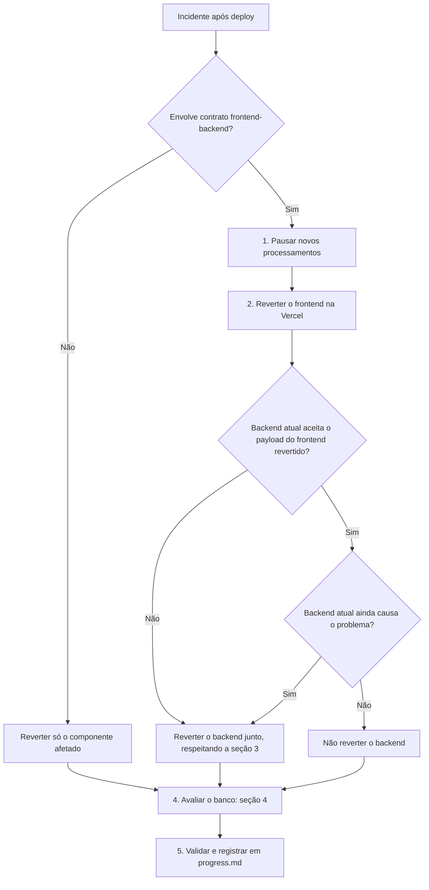

# Estratégia de Rollback

**Data:** 2026-10-12
**Status:** procedimento documentado; **ainda não testado em produção** (não há deploy de produção real até esta data, ver `checklist-go-live.md`). Recomenda-se um exercício de rollback em ambiente de teste antes do go-live.
**Relacionados:** `backup-restore-postgres.md` (restauração de dados), `checklist-go-live.md` (item "Sem estratégia de rollback documentada"), `../arquitetura/visao-fluxo-processamento-video.md` (fluxo do pipeline de vídeo).

> **Regra do projeto (AGENTS.md):** nenhuma ação que altere produção (rollback, `modal deploy`, `git push`, aplicação de migration) é executada sem autorização explícita do responsável pelo projeto.

---

## 1. Como o deploy funciona hoje

O que está abaixo foi conferido lendo o repositório em 2026-10-12. O que não pôde ser conferido no repositório aparece marcado como **a confirmar**.

| Componente | Mecanismo de publicação | Evidência no repositório | Situação |
|---|---|---|---|
| Frontend (`ai-podcast-clipper-frontend/`) | Vercel | Não existe `vercel.json` (item aberto no checklist: "Sem `vercel.json`"). `.github/workflows/ci.yml` não tem nenhum job de deploy. `@vercel/otel` está em `package.json`, e o checklist menciona "previews da Vercel". | **A confirmar.** Presume-se integração direta Git → Vercel (deploy disparado pelo push, fora de `.github/workflows/`). Confirmar no painel da Vercel. |
| Backend (`ai-podcast-clipper-backend/`) | `modal deploy main.py` (app `ai-podcast-clipper`, definido em `main.py`) | `AGENTS.md`; `main.py` | Comando manual documentado. Não há workflow de deploy do Modal no repositório. |
| Migrations Prisma | Script `npm run db:migrate` = `prisma migrate deploy` (`package.json`) | O job `frontend` do CI aplica migrations só no Postgres 16 efêmero do próprio job. Nenhum job aplica migrations em produção. | **A confirmar:** quem, quando e com qual comando as migrations são aplicadas em produção. |
| Funções Inngest | Servidas em `/api/inngest` pelo deployment do frontend | `checklist-go-live.md` (route handler `/api/inngest`) | Acompanha o deploy do frontend. |
| Secrets e env vars | Env vars da Vercel; secret do Modal `ai-podcast-clipper-secret` | `docs/operacao/modal-secret-checklist.md` | Não são versionados no repositório. |
| Healthcheck | `GET /api/health` | `ai-podcast-clipper-frontend/src/app/api/health/route.ts` (lido em 2026-10-12): retorna `{ "status": "ok" }` fixo | **Não checa dependências** (banco, Stripe, S3, Inngest). Ver seção 6. |

### O que um rollback de código NÃO desfaz

- Schema do banco (migrations): ver seção 4.
- Valores de env vars e secrets: o rollback de deployment não reaplica variáveis alteradas depois do build restaurado (Vercel) e o secret do Modal não é versionado.
- Dados gravados durante a versão ruim (`CreditTransaction`, `Subscription`, objetos no S3, status de projetos e clipes).
- Execuções Inngest em andamento e eventos do Stripe/Clerk já processados.

Por isso, o rollback de código é apenas uma das ferramentas. Dados afetados exigem avaliação separada (ver `backup-restore-postgres.md`).

---

## 2. Rollback do frontend (Vercel)

### Opção A: Instant Rollback (preferida)

Pelo painel: **Projeto → Production Deployment → Instant Rollback → escolher o deployment anterior estável → Continue.**

Pela CLI: `vercel rollback [deployment-id-ou-url]`.

Comportamento segundo a documentação da Vercel (consultada em 2026-10-12; **a confirmar com a doc atual e com o plano em uso**):

- O rollback reatribui os domínios de produção a um build já existente, sem reconstruí-lo. É rápido, mas alterações de variáveis de ambiente feitas depois daquele build não são refletidas.
- Cron jobs também voltam ao estado do deployment restaurado.
- Limite por plano: em Pro e Enterprise é possível voltar a qualquer deployment que já tenha sido produção; no Hobby, só ao deployment imediatamente anterior.
- Para desfazer o rollback: `vercel promote [deployment-id-ou-url]` (ou "Promote to Production" no painel). Enquanto isso não for feito, novos pushes à branch de produção não entram automaticamente em produção.

### Opção B: `git revert` (quando a Opção A não está disponível ou é preciso reconstruir a versão)

1. Identificar o(s) commit(s) problemático(s) em `main` (`git log --oneline main`).
2. Criar uma branch, reverter e abrir PR:
   ```bash
   git checkout -b hotfix/revert-<hash>
   git revert --no-edit <hash-mais-recente>
   ```
   Para reverter um intervalo de commits, use `git revert --no-edit <mais-antigo>^..<mais-recente>`.
3. O PR dispara o job `frontend` e o job `backend` do `ci.yml`. Após o merge, o push em `main` roda o CI de novo. Se a integração Git → Vercel estiver confirmada, o deploy segue o merge.

Observações:

- A Opção B é mais lenta que a A, pois exige CI e rebuild.
- `git revert` não reverte migrations (seção 4).
- O hook `pre-push` (Husky) roda a suíte completa antes de qualquer push. A exceção `HUSKY=0 git push` existe no AGENTS.md apenas para emergências já testadas manualmente e com autorização do responsável.

---

## 3. Rollback do backend (Modal)

### O que a documentação da Modal diz

Consultada em 2026-10-12 (`modal.com/docs/guide/managing-deployments`):

- O histórico de deployments do app está na aba **Deployment History** do dashboard e pode ser listado com `modal app list`.
- O rollback é feito por `modal app rollback` (CLI) ou pela aba Deployment History. **Segundo a página, o rollback está disponível apenas nos planos Team e Enterprise.** Os argumentos do comando não aparecem na página: rodar `modal app rollback --help` antes de usar. **A confirmar** com a doc atual e com o plano do projeto.
- Cada rollback incrementa a versão do app, é atribuído ao usuário que o disparou e restaura as Functions e os metadados do app ao estado anterior, independentemente do código atual do repositório.
- `modal deploy` sem nenhuma mudança é um no-op: a versão não incrementa.

### Procedimento A: rollback nativo da Modal (plano Team ou Enterprise)

```bash
modal app list
modal app rollback --help    # confirmar os argumentos antes de executar
modal app rollback <argumentos confirmados no --help>
```

### Procedimento B: redeploy do código de uma versão estável

Usar quando o plano não tem rollback nativo ou a versão desejada não está no histórico da Modal. O deploy é feito a partir de um checkout do commit ou tag estável, para não misturar código atual com código antigo.

```bash
# Dentro do repositório principal
git worktree add <diretorio-temporario-fora-do-repo> <tag-ou-commit-estavel>

# Dentro do worktree: o diretório asd/ é um submodule (ver .gitmodules na raiz)
cd <diretorio-temporario-fora-do-repo>
git submodule update --init ai-podcast-clipper-backend/asd

cd ai-podcast-clipper-backend
modal deploy main.py
```

Pontos de atenção:

- `main.py` inclui `asd/` na imagem com `add_local_dir("asd", ...)`. Se o `asd/` da versão alvo não estiver presente, o build falha. Em 2026-10-12, `git status` do repositório reporta `ai-podcast-clipper-backend/asd` como não rastreado, apesar de ser um gitlink no índice. **Confirmar o estado do submodule antes de qualquer redeploy de versão antiga.**
- Remover o worktree depois: `git worktree remove <diretorio-temporario-fora-do-repo>`.

### Restrição de compatibilidade do contrato `/process_video` (crítica)

O backend mudou o contrato de `POST /process_video` em 2026-10-09 (contrato v2, ver `checklist-go-live.md`, item de cortes manuais):

| Versão do backend | Campos desconhecidos | Efeito de `mode: "manual"` + `manual_cuts` |
|---|---|---|
| v2 (atual, `core/schemas.py`) | `extra="forbid"`: resposta **422** (falha visível) | Processa exatamente os cortes enviados. `mode` default é `"auto"`. |
| v1 (anterior a 2026-10-09) | Descartados **silenciosamente** pelo Pydantic | Ignora os cortes e roda o pipeline automático (Gemini), enquanto o crédito foi reservado no preço manual. |

**Consequência:** reverter o backend para uma versão anterior a 2026-10-09 enquanto o frontend atual envia cortes manuais gera processamento errado e cobrança incorreta, sem nenhum erro visível. Antes de reverter o backend para v1, reverter o frontend (ou impedir a criação de projetos com cortes manuais). A ordem completa está na seção 5.

### Secrets

O rollback do Modal não altera o secret `ai-podcast-clipper-secret`. Se a versão alvo espera uma variável diferente da atual, ajustar o secret antes do rollback. Ver `modal-secret-checklist.md`.

---

## 4. Rollback de migrations (Prisma)

### Fatos verificados

- A CLI do Prisma instalada no projeto (`prisma migrate resolve --help`) oferece apenas `--applied` e `--rolled-back`. **Não existe comando de "down" automático.**
- `prisma migrate resolve` altera somente a tabela `_prisma_migrations`. Ele **não executa SQL**.
- Segundo a documentação do Prisma (resultado de pesquisa, **a confirmar na doc oficial antes de um incidente real**), o fluxo de `--rolled-back` é descrito para migrations que **falharam**. Para uma migration já aplicada com sucesso, a orientação é reverter o `schema.prisma` ao estado anterior e gerar uma nova migration (forward).

### Regra: forward-fix por padrão

Em produção, a correção de uma migration ruim é uma **nova migration** que desfaz o efeito. Editar o histórico de migrations manualmente só deve ocorrer para uma migration que falhou no meio.

### Árvore de decisão

**1. A migration falhou no meio do `prisma migrate deploy`.**

1. Verificar o estado (comando de leitura, `DATABASE_URL` apontando para o banco de produção):
   ```bash
   cd ai-podcast-clipper-frontend
   npx prisma migrate status
   ```
2. Corrigir o SQL ou desfazer manualmente o que ficou parcialmente aplicado.
3. Marcar a migration como revertida no histórico e reexecutar:
   ```bash
   npx prisma migrate resolve --rolled-back <nome-da-migration>
   npx prisma migrate deploy
   ```
4. Se o schema ficou inconsistente e não há correção segura, usar o restore descrito em `backup-restore-postgres.md`.

**2. A migration foi aplicada com sucesso, mas o código precisa voltar.**

- **Migration aditiva** (tabela nova, coluna nova nullable, índice novo): **deixar a migration aplicada.** O código antigo ignora o que não conhece. Exemplos no projeto:
  - `20260927000000_add_processed_webhook_event` (tabela nova)
  - `20261003000000_add_subscription_past_due_at` (campo `pastDueAt` nullable)
  - `20261012194633_add_missing_fk_indexes` (apenas índices)
- **Migration que restringe ou normaliza dados:** o código antigo pode falhar, e reverter o código não desfaz a normalização já feita. Exemplo: `20260928000000_restrict_user_subscription_plan_values` normaliza dados legados e adiciona uma CHECK constraint. Código antigo que grava valores fora do conjunto permitido passa a falhar. Nesse caso, a correção é uma migration forward.
- **Baseline `20260926000000_baseline_initial_schema`:** nunca reverter. Ela só existe para ambientes novos.

**Criando a migration reversa (caminho recomendado):**

1. Em desenvolvimento, reverter o `schema.prisma` ao estado anterior à migration problemática.
2. Gerar a migration:
   ```bash
   cd ai-podcast-clipper-frontend
   npx prisma migrate dev --name revert_<assunto>
   ```
   (`npm run db:generate` é o atalho para `prisma migrate dev`.)
3. Revisar o SQL gerado e rodar os testes (`npm run test:integration`).
4. Após autorização, aplicar em produção com `npm run db:migrate` (`prisma migrate deploy`).

**Emergência (sem tempo para migration nova):** SQL manual via `prisma db execute`, seguido de ajuste do histórico com `migrate resolve`. É exceção: fazer backup antes (`backup-restore-postgres.md`) e registrar tudo em `progress.md`.

### Verificação de drift antes e depois

```bash
cd ai-podcast-clipper-frontend
npx prisma migrate diff \
  --from-url "$DATABASE_URL" \
  --to-schema-datamodel prisma/schema.prisma \
  --exit-code
```

Exit code `0` significa que o banco está alinhado ao `schema.prisma`. Exit code `2` significa que há diferenças.

---

## 5. Ordem de rollback quando frontend e backend mudaram juntos

**Princípio:** reverter primeiro quem **emite** o contrato novo (frontend), depois quem **recebe** (backend), e só então avaliar o banco.



### Passo a passo

1. **Pausar novos processamentos.** O repositório não documenta feature flag nem kill switch. **A confirmar:** se as funções Inngest podem ser pausadas pelo painel. Sem isso, a forma mais direta de impedir novas requisições é reverter o frontend primeiro (passo 2).
2. **Reverter o frontend** (seção 2).
3. **Verificar compatibilidade** com o backend atual. O contrato v2 aceita payload sem `mode` (default `"auto"`), então um frontend antigo que não envia `mode` continua funcionando.
4. **Reverter o backend somente se ainda for necessário**, e respeitando a restrição da seção 3: nunca para uma versão v1 enquanto o frontend em produção enviar cortes manuais.
5. **Avaliar o banco** (seção 4). Migrations aditivas geralmente ficam aplicadas.

### Matriz por tipo de release

| Release | Ordem de rollback |
|---|---|
| Só frontend | Frontend. O backend não muda. |
| Só backend | Backend. Antes, confirmar se o frontend atual envia campos que a versão alvo ignoraria silenciosamente (seção 3). Se sim, pausar a origem antes. |
| Frontend e backend com contrato novo | Frontend primeiro; backend depois, se necessário. |
| Inclui migration | Código primeiro; banco conforme seção 4. |

---

## 6. Critérios para acionar rollback

**Os limiares abaixo são propostas**, ainda não aprovadas pelo responsável. Não há monitoramento com alertas externos em produção (item "Observabilidade sem exportação externa" aberto no checklist). Por isso, a detecção é manual até esse item ser fechado.

| Sinal | Acionar rollback quando | Ação | Como é detectado hoje |
|---|---|---|---|
| Cobrança incorreta | **Qualquer ocorrência**: débito de crédito divergente do modo de processamento (RN-PIPE-MANUAL-15) ou `CreditTransaction` duplicada | Rollback imediato + pausa de processamentos. Investigar antes de reativar. | Consulta manual ao banco (`CreditTransaction`) |
| Webhook Stripe | Resposta 5xx sustentada em `/api/webhooks/stripe` após o deploy | Rollback do frontend | Logs (a confirmar onde ficam em produção) |
| Autenticação | Falha de criação de conta ou login após o deploy (webhook `user.created` do Clerk falhando) | Rollback do frontend | Logs |
| Processamento de vídeo | **Proposta:** mais de 50% dos projetos iniciados após o deploy em `failed` por erro do backend, em uma janela de 30 minutos | Rollback do backend, respeitando a seção 5 | Status de projetos/clipes no banco e logs |
| Falha de build ou deploy | Build ou deploy não conclui | Nenhum rollback necessário se a versão anterior continuar servindo produção (**a confirmar** na Vercel) | Painel do provedor |
| Migration | Falha ou aplicação parcial de migration | Não reverter código às cegas. Seguir a seção 4 e, se necessário, o restore. | Saída do `prisma migrate deploy` |
| Healthcheck | **Não usar como gatilho.** `/api/health` retorna 200 fixo. | — | Item aberto no checklist ("Healthcheck não valida dependências") |

---

## 7. Procedimento de execução

1. Declarar o incidente e registrar horário e sintoma.
2. Identificar a última versão estável (commit, tag ou ID do deployment da Vercel e da Modal).
3. Obter autorização explícita do responsável pela ação em produção.
4. Pausar novos processamentos (seção 5, passo 1).
5. Executar o rollback na ordem da seção 5.
6. Validar: login, criação de projeto por YouTube, processamento de um vídeo curto de teste e conferência de que as `CreditTransaction` geradas batem com o esperado.
7. Reativar gradualmente e observar.
8. Registrar em `progress.md` e abrir a análise pós-incidente. Se houve dados afetados, avaliar o restore (`backup-restore-postgres.md`).

---

## 8. Pendências e itens a confirmar

- **Vercel:** plano em uso e se o deploy de produção é disparado por integração Git (não versionado no repositório).
- **Modal:** plano do projeto (rollback nativo exige Team ou Enterprise) e os argumentos de `modal app rollback`, a confirmar com `modal app rollback --help`.
- **Migrations em produção:** não há job no CI nem script versionado que as aplique em produção. Definir e documentar o processo.
- **Pausa de processamentos:** não há feature flag ou kill switch documentado.
- **Submodule `asd/`:** estado de rastreamento divergente (ver seção 3). Confirmar antes de qualquer redeploy de versão antiga.
- **Teste do procedimento:** nenhum rollback foi executado ou ensaiado até esta data.
